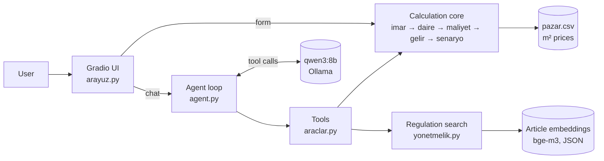

# Müteahhit Fizibilite Asistanı

A local AI assistant for small residential construction projects in **Alanya / Antalya, Turkey**.
Given a plot and its zoning parameters, it estimates buildable area, apartment mix, construction cost,
sales revenue and the contractor's profit, and answers questions about the zoning regulation.

Everything runs locally: a tested Python calculation core, an agent on top of a local LLM
(Ollama, `qwen3:8b`) that calls the calculations as tools, and RAG over the
*Planlı Alanlar İmar Yönetmeliği* (Turkish zoning regulation).

**The LLM never does the math.** Every number comes from the calculation code; the model only
decides which tool to call and explains the result.

> ⚠️ **For information only.** A learning project, not investment, legal or engineering advice.
> Prices and costs are rough public averages and assumptions. Always check the official zoning
> status (imar durumu) of a parcel and real local prices before making any decision.


## Features

- **Feasibility calculator:** zoning (TAKS, emsal, floor limit) → apartment mix → cost → revenue → profit,
  for both land purchase and *kat karşılığı* (landowner receives a share of the units).
- **Sensitivity analysis:** how profit changes with the landowner's share, sale price, emsal, etc.
- **Agent:** ask in plain Turkish (*"Mahmutlar'da 1000 m² arsam var... kârlı mı?"*); the model calls the tools,
  asks for missing data instead of guessing, and recovers from tool errors.
- **Regulation search (RAG):** *"Balkonlar emsale dahil mi?"* → finds the relevant articles and cites them.
- **Web UI (Gradio):** an instant calculator form and a chat tab that shows which tools were called.
- **Evaluation script:** measures the agent on 10 cases, 3 runs each.

## Architecture



| Module | Role |
|---|---|
| `imar.py` | Footprint, total floor area, number of floors |
| `daire.py` | Net usable area, apartment mix (1+1, 2+1, 3+1) |
| `maliyet.py` | Building class + official unit construction cost |
| `gelir.py` | Sales revenue, profit (land purchase or kat karşılığı) |
| `senaryo.py` | Chains the above, compares scenarios |
| `araclar.py` | Tool definitions (JSON Schema) + argument cleaning |
| `agent.py` | Tool-calling loop with step limit and conversation memory |
| `yonetmelik.py` | Downloads the regulation, splits it into articles, embeds and searches |
| `llm.py` | Single-shot explanation of a result |
| `arayuz.py` | Gradio web interface |
| `degerlendirme.py` | Agent evaluation |

## Evaluation

`python -m src.degerlendirme` runs 10 cases × 3 runs against the local model. Expected numbers come
from the calculation code, so this measures the **model's behaviour**, not the formulas
(those are covered by unit tests).

- **arac:** the right tool was called with the right arguments (the tool returned the expected profit)
- **rakam:** the number in the answer matches the tool output (±0.06 M TL)
- **yon:** profit/loss direction stated correctly
- **madde / yasak:** the regulation answer cites the right article and doesn't contain a known wrong claim
- **sormali:** with missing data, the agent asks instead of inventing values

<!-- EVAL_SONUC -->
_Results will be added here._

## Design decisions

- **Calculations in code, not in the LLM.** An 8B model reads numbers correctly but misreads their
  relationships (in early tests it compared costs with gross revenue instead of the contractor's share).
  The prompt now states the profit formula explicitly, and all arithmetic stays in tested code.
- **Argument cleaning instead of prompt rules.** Small models send `45`, `"%45"` or `0.45` for the same
  ratio, `TAKS` instead of `taks`, and fill unknown fields with `0`. These are normalised in code;
  invalid calls return `{"hata": ...}` so the model can retry instead of crashing the loop.
- **No vector database.** The regulation is ~230 chunks. A JSON file with normalised vectors and a
  plain cosine search is enough; Chroma would only add a dependency.
- **Hybrid search.** 80% embedding similarity + 20% keyword overlap, so exact terms like *bodrum* or
  *otopark* are not missed. `bge-m3` is used because it is multilingual.
- **Thinking mode off.** `qwen3` reasons before every tool call by default, which made each step
  5–10× slower without improving tool selection.

## Data and assumptions

| Input | Source | Reliability |
|---|---|---|
| Unit construction cost | Ministry of Environment 2026 table (Resmî Gazete, 3 Feb 2026, No. 33157) | Official, not market cost: excludes VAT, includes 15% overhead + 10% contractor profit |
| m² sale prices (`data/pazar.csv`) | Emlakjet listing averages, Sep 2026 | Asking prices, include older buildings |
| Apartment sizes (60 / 95 / 130 m²), common area 15% | Assumption | To be replaced with local data |
| Regulation text | mevzuat.gov.tr (downloaded at setup, current version) | Official |

## Known limitations

- **Areas excluded from emsal are not modelled.** Balconies, stairs and parking can add up to 30% of the
  emsal area (Madde 5), so the real built area — and cost — can be noticeably higher than calculated.
- **Regulation answers are the weakest part.** Retrieval finds the right articles, but the 8B model
  sometimes mixes articles or inverts a rule. Treat regulation answers as pointers to the article,
  not as legal answers. Parcel-specific plan notes always override the general regulation.
- **PDF extraction artefacts.** `pypdf` splits some words (*"k onut"*); search still works but text is imperfect.
- Financing cost, time to sell, basements and setbacks are not modelled.

## Setup

Requirements: Python 3.11+, [Ollama](https://ollama.com), ~8 GB VRAM recommended (tested on RTX 5060 8 GB, WSL2).

```bash
git clone https://github.com/kaan-svg/muteahhit-fizibilite.git
cd muteahhit-fizibilite
python3 -m venv .venv && source .venv/bin/activate
pip install -r requirements.txt
pytest

ollama pull qwen3:8b
ollama pull bge-m3
python -m src.yonetmelik kur      # download regulation + build search index (once)

python -m src.arayuz              # web UI at http://localhost:7860
python -m src.agent               # or chat in the terminal
```

If Ollama runs on Windows and the code in WSL, enable mirrored networking
(`[wsl2] networkingMode=mirrored` in `%UserProfile%\.wslconfig`) so `localhost:11434` is reachable.

## Glossary

| Term | Meaning |
|---|---|
| TAKS | Footprint / plot area |
| Emsal (KAKS) | Total floor area / plot area |
| Kat karşılığı | Landowner provides the plot and receives a share of the finished units instead of cash |
| Yapı sınıfı (III-A … IV-B) | Building class used for the official unit construction cost |

## Roadmap

- [x] Calculation core with tests
- [x] Local LLM, tools, agent loop
- [x] RAG over the zoning regulation
- [x] Gradio UI
- [x] Evaluation script
- [ ] Model areas excluded from emsal (balconies, parking, shelters)
- [ ] Real Alanya prices, unit sizes and construction costs from local sources
- [ ] Compare with a real completed project
